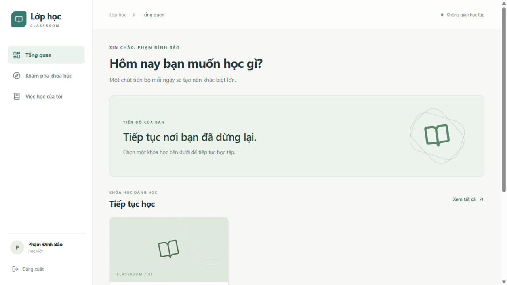
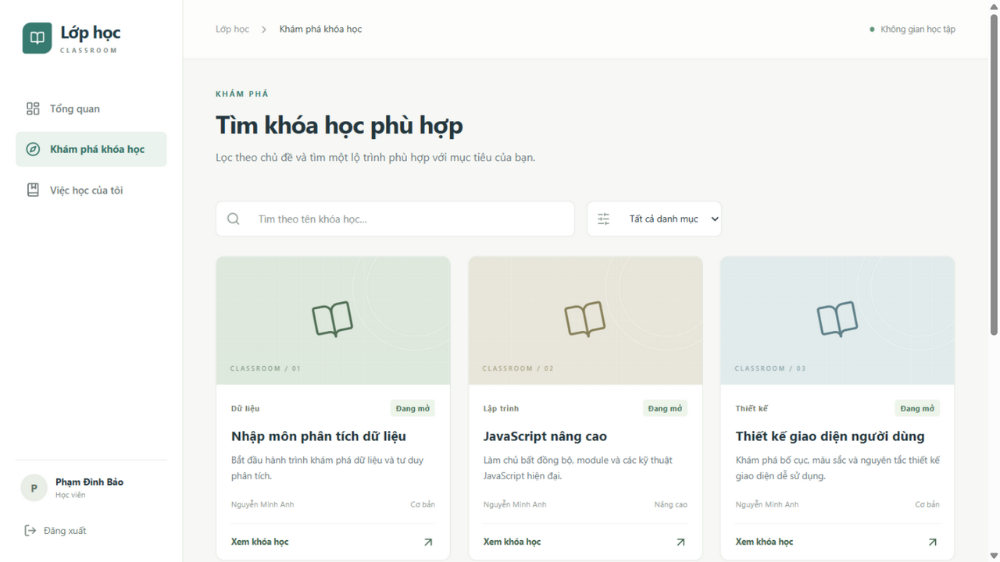
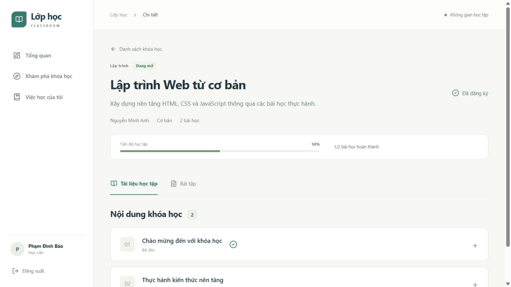
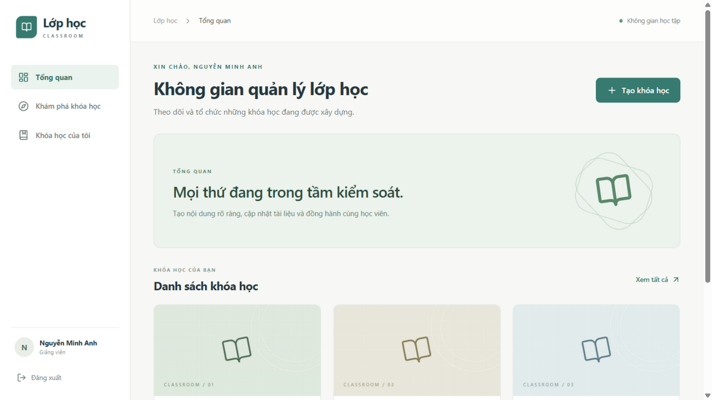
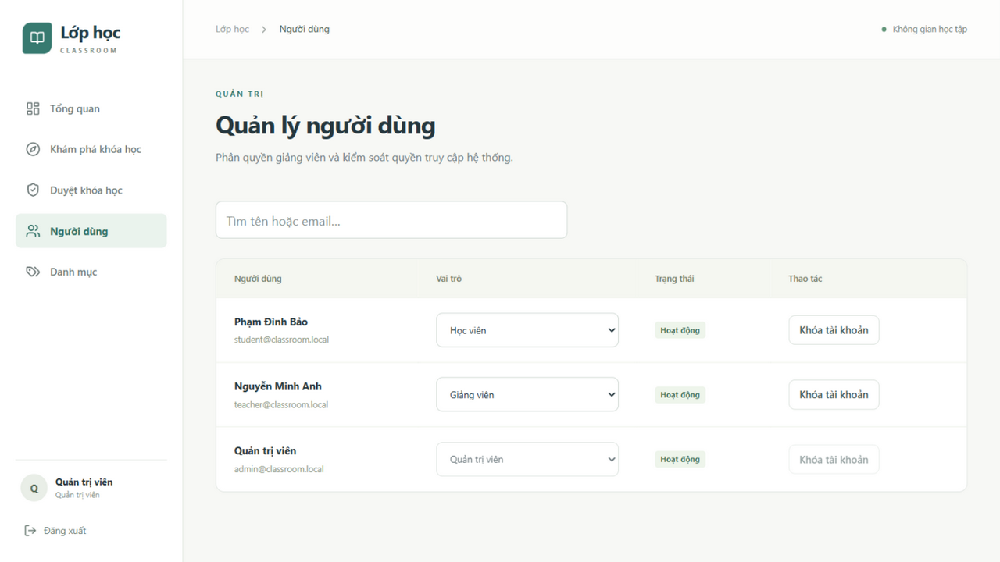

# Online Classroom

Báo cáo cuối kỳ môn Lập trình Web

Sinh viên thực hiện: **Phạm Đình Bảo**  
Mã số sinh viên: **1822040642**  
Hình thức thực hiện: **Cá nhân**  
Công nghệ: **MongoDB, Express, React và Node.js (MERN)**

## 1. Giới thiệu đề tài

Online Classroom là ứng dụng lớp học trực tuyến được xây dựng để gom các hoạt động học tập vào một quy trình thống nhất. Người học có thể tìm khóa học đang mở, ghi danh, đọc bài học, theo dõi tiến độ và nộp bài ngay trong lớp. Ở phía quản lý, giảng viên tổ chức khóa học, danh mục, bài học và bài tập; quản trị viên quản lý tài khoản và danh mục. Cách tổ chức này giúp thông tin khóa học, nội dung học và kết quả bài nộp được liên kết thay vì nằm rời rạc ở nhiều nơi.

Mục tiêu của đề tài không chỉ là tạo các màn hình hiển thị dữ liệu mà còn bảo vệ các thao tác ở API. Mật khẩu được băm bằng bcrypt, phiên đăng nhập dùng JWT, còn việc kiểm tra vai trò, chủ sở hữu khóa học và trạng thái ghi danh được thực hiện ở backend. Báo cáo mô tả phiên bản đã triển khai và các kết quả kiểm chứng được cung cấp cùng mã nguồn; các đề xuất chưa thực hiện được tách riêng ở phần hướng phát triển.

## 2. Phạm vi và chức năng

Ứng dụng có ba nhóm quyền chính. Quản trị viên quản lý người dùng, khóa hoặc mở khóa tài khoản và duy trì danh mục khóa học. Giảng viên tạo và quản lý khóa học, thêm bài học, giao bài tập, xem danh sách sinh viên và chấm bài kèm nhận xét. Sinh viên xem danh mục khóa học đang mở, ghi danh, đọc tài liệu, đánh dấu bài học đã hoàn thành và gửi bài làm.

Một khóa học có thể ở trạng thái bản nháp, đã mở hoặc đã đóng. Khóa học bản nháp chưa xuất hiện trong danh sách để sinh viên ghi danh. Bài học hỗ trợ nội dung văn bản, liên kết video và tệp PDF; bài tập có hạn nộp và điểm tối đa, còn bài nộp có thể chứa văn bản hoặc tệp đính kèm. Sau khi bài đã được chấm, lần nộp mới không được ghi đè kết quả đã chấm.

## 3. Kiến trúc và tổ chức mã nguồn

React đảm nhiệm giao diện trình duyệt bằng functional components, hooks và Context. Express chạy trên Node.js cung cấp REST API, nhận yêu cầu và chuyển nghiệp vụ đến các controller. MongoDB được truy cập qua các schema Mongoose để lưu người dùng, khóa học, nội dung học và bài nộp. Nhờ tách lớp như vậy, giao diện chịu trách nhiệm trình bày và điều hướng, trong khi backend giữ vai trò kiểm tra dữ liệu, quyền truy cập và trạng thái nghiệp vụ.

Mã nguồn phía client nằm trong `client/src`, gồm phần khởi tạo ứng dụng, Context, các trang và CSS. Phía server được chia thành `models`, `controllers`, `routes`, `middleware` và các mô-đun cấu hình, seed, upload. Router gắn dưới tiền tố `/api`; middleware xác thực được áp dụng sau các route công khai cho health check, đăng ký và đăng nhập. Các route yêu cầu quyền đều kiểm tra JWT và vai trò ở server, không phụ thuộc vào việc nút thao tác có được hiển thị trên giao diện hay không.

## 4. Thiết kế cơ sở dữ liệu

Các model dùng timestamps và ẩn trường phiên bản khi chuyển sang JSON. Người dùng có tên, email duy nhất, mật khẩu, vai trò và trạng thái bị khóa; phương thức chuyển JSON loại bỏ mật khẩu trước khi trả dữ liệu. Category lưu tên danh mục duy nhất và mô tả. Course liên kết với Category và User giữ vai trò giảng viên, đồng thời có cấp độ và trạng thái. Bảng dưới đây tóm tắt trách nhiệm và quan hệ chính của từng nhóm dữ liệu.

| Collection | Trường và quan hệ chính | Vai trò trong nghiệp vụ |
| --- | --- | --- |
| Users | `name`, `email`, `password`, `role`, `isBlocked` | Danh tính, xác thực và phân quyền |
| Categories | `name`, `description` | Phân loại khóa học; tên là duy nhất |
| Courses | `title`, `description`, `category`, `teacher`, `level`, `status` | Khóa học và trạng thái mở ghi danh |
| Enrollments | `course`, `student`, `completedLessons` | Ghi danh và tiến độ bài học |
| Assignments | `course`, `title`, `description`, `dueDate`, `maxScore` | Yêu cầu bài tập và hạn nộp |
| Lessons | `course`, `title`, `type`, `content`, `videoUrl`, `file` | Nội dung văn bản, video hoặc PDF |
| Submissions | `assignment`, `student`, `text`, `file`, `grade`, `feedback` | Bài làm, điểm và nhận xét |

Enrollment nối một sinh viên với một khóa học và có unique index trên cặp `course`–`student`, nhờ đó một sinh viên không thể tạo bản ghi ghi danh trùng. Submission cũng có unique index trên cặp `assignment`–`student`, phù hợp với quy tắc mỗi sinh viên có một bài nộp cho một bài tập. Các trường tệp được lưu với tên tệp, tên gốc, MIME type và kích thước; nội dung tệp không được đưa vào phản hồi thông thường khi schema đặt `select: false`.

## 5. Thiết kế API

API dùng JSON cho các thao tác nghiệp vụ và dùng middleware upload ở những route nhận tệp. Đăng ký và đăng nhập là các route công khai, được giới hạn tần suất; các route còn lại đi qua middleware JWT. Sau khi xác thực, middleware vai trò phân biệt `admin`, `teacher` và `student`. Bảng sau ghi các endpoint đã đối chiếu trong router của phiên bản hoàn thành.

| Phương thức và đường dẫn | Quyền truy cập | Chức năng chính |
| --- | --- | --- |
| `GET /api/health` | Công khai | Kiểm tra trạng thái API |
| `POST /api/auth/register` | Công khai | Đăng ký tài khoản sinh viên |
| `POST /api/auth/login` | Công khai | Đăng nhập và nhận JWT |
| `GET /api/auth/me` | Đã đăng nhập | Lấy thông tin tài khoản hiện tại |
| `GET /api/users` | Admin | Xem danh sách người dùng |
| `PATCH /api/users/:id` | Admin | Cập nhật trạng thái hoặc vai trò người dùng |
| `GET /api/categories` | Đã đăng nhập | Xem danh mục |
| `POST/PATCH/DELETE /api/categories...` | Admin | Quản lý danh mục |
| `GET /api/courses` và `GET /api/courses/:id` | Đã đăng nhập | Xem danh sách và chi tiết khóa học |
| `POST/PATCH/DELETE /api/courses...` | Teacher hoặc admin | Tạo, sửa và xóa khóa học |
| `POST /api/courses/:id/enroll` | Student | Ghi danh vào khóa học |
| `PATCH /api/courses/:id/progress` | Student | Cập nhật bài học đã hoàn thành |
| `GET /api/enrollments/me` | Student | Xem các khóa học đã ghi danh |
| `POST/PATCH/DELETE /api/courses/:courseId/lessons...` | Teacher hoặc admin | Quản lý bài học và tệp học liệu |
| `POST/PATCH/DELETE /api/courses/:courseId/assignments...` | Teacher hoặc admin | Quản lý bài tập |
| `POST /api/assignments/:id/submissions` | Student | Nộp bài và tệp đính kèm |
| `PATCH /api/submissions/:id/grade` | Teacher hoặc admin | Chấm bài và lưu nhận xét |

Các endpoint chi tiết bài tập, tệp bài học và tệp bài nộp được bảo vệ theo quan hệ sở hữu hoặc ghi danh tương ứng. Vì vậy, một JWT còn hạn không tự động cho phép truy cập mọi tài nguyên; backend vẫn kiểm tra tài khoản bị khóa, vai trò và quan hệ với khóa học trước khi xử lý.

## 6. Giao diện và quy trình sử dụng

Các ảnh dưới đây được chụp từ bản chạy trình duyệt tại `http://localhost:5173`. Dashboard sinh viên thể hiện khu vực học tập của người đã đăng nhập; danh mục khóa học cho thấy luồng tìm lớp; trang chi tiết là nơi người học xem nội dung trước khi tiếp tục học. Hai ảnh còn lại minh họa các khu vực dành cho giảng viên và quản trị viên, qua đó cho thấy giao diện thay đổi theo vai trò tài khoản.











Luồng sử dụng của sinh viên bắt đầu từ danh mục, chuyển sang chi tiết khóa học rồi ghi danh và theo dõi bài học. Luồng của giảng viên bắt đầu ở khu vực quản lý khóa học, nơi có thể chuẩn bị nội dung và bài tập trước khi mở lớp. Quản trị viên có một khu vực riêng để kiểm soát người dùng. Ảnh chụp chứng minh trạng thái giao diện quan sát được; các kết luận về API và bảo mật được dựa trên mã nguồn và kiểm thử, không suy ra chỉ từ hình ảnh.

## 7. Hướng dẫn cài đặt và chạy

Môi trường cần Node.js từ phiên bản 22 và npm. Tại thư mục gốc, cài thư viện cho cả client và server bằng lệnh sau:

```bash
npm run install:all
```

Để chạy thử với dữ liệu mẫu, dùng chế độ demo:

```bash
npm run dev:demo
```

Chế độ demo khởi động MongoDB bằng `mongodb-memory-server` và lưu dữ liệu phát triển trong `server/.data`. Lần đầu chạy cần Internet để tải MongoDB binary. Giao diện mặc định ở `http://localhost:5173`, còn API ở `http://localhost:5000/api`. Ba tài khoản mẫu là `admin@classroom.local`, `teacher@classroom.local` và `student@classroom.local`, cùng dùng mật khẩu `Classroom@123`; đây chỉ là thông tin phục vụ trình diễn cục bộ.

Khi dùng MongoDB local hoặc Atlas, sao chép tệp cấu hình mẫu, điền `MONGODB_URI` và thay `JWT_SECRET` bằng chuỗi bí mật đủ mạnh. Git Bash, macOS và Linux dùng:

```bash
cp server/.env.example server/.env
npm run seed
npm run dev
```

Trong PowerShell, lệnh sao chép tương đương là `Copy-Item server/.env.example server/.env`. Với Atlas, cần cấu hình tài khoản cơ sở dữ liệu và danh sách IP được phép kết nối. Không đưa secret, mật khẩu thật hoặc dữ liệu cá nhân lên repository.

Các lệnh kiểm thử, build và chạy bản build là:

```bash
npm test
npm run build
npm start
```

Sau khi build, frontend được biên dịch vào `client/dist`; lệnh `npm start` để Express phục vụ bản build tại `http://localhost:5000`. Chế độ `npm run dev` phù hợp cho phát triển giao diện với tự động tải lại.

## 8. Kiểm thử và đánh giá

Bộ kiểm thử API hoàn thành với kết quả **9/9 kiểm thử đạt trong 4,17 giây**. Kết quả này được ghi nhận bằng lệnh `npm test`, bên cạnh việc build frontend cũng hoàn thành với Vite 6.4.6 trong 2,68 giây khi chạy `npm run build`. Việc tách hai kết quả giúp phân biệt kiểm tra nghiệp vụ phía server với kiểm tra khả năng biên dịch và đóng gói giao diện.

| Hạng mục | Lệnh hoặc môi trường | Kết quả thực tế |
| --- | --- | --- |
| Kiểm thử API | `npm test` | PASS, 9/9 trong 4,17 giây |
| Build giao diện | `npm run build` | PASS, Vite 6.4.6 trong 2,68 giây |
| Kiểm tra trình duyệt | Demo tại `localhost:5173` | Đã xác minh root và chụp 5 màn hình theo vai trò/chức năng |

Kết quả kiểm thử được đọc cùng các thay đổi bảo mật ở backend: route đăng nhập và đăng ký có giới hạn tần suất, route nghiệp vụ yêu cầu JWT, còn quyền admin, teacher và student được kiểm tra ở server. Mã nguồn đã được tạo repository GitHub công khai tại https://github.com/CodeWithBao/online-classroom-mern; repository không chứa node_modules, .env hoặc dữ liệu MongoDB cục bộ.

## 9. Kết luận và hướng phát triển

Phiên bản hoàn thành đã nối được ba lớp chính của một ứng dụng MERN: giao diện React, API Express/Node.js và dữ liệu MongoDB. Các vai trò người dùng được phản ánh cả trên giao diện lẫn ở middleware backend; mô hình dữ liệu tách ghi danh, bài tập, bài học và bài nộp để hỗ trợ quy trình học tập có theo dõi. Kết quả 9/9 kiểm thử API đạt, build frontend thành công và năm ảnh chụp từ trình duyệt cung cấp cơ sở kiểm chứng cho phạm vi đã mô tả.

Hướng phát triển có thể tập trung vào mở rộng thông báo hạn nộp, báo cáo tiến độ theo khóa học, tìm kiếm nâng cao và cải thiện cơ chế lưu trữ tệp khi triển khai thật. Những nội dung này chưa được xem là chức năng đã hoàn thành trong phiên bản báo cáo. Nếu đưa hệ thống lên môi trường công khai, cần thay tài khoản demo, quản lý secret ngoài mã nguồn, cấu hình MongoDB/Atlas phù hợp và bổ sung quy trình giám sát, sao lưu và phân quyền vận hành.
